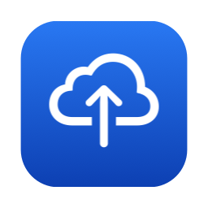
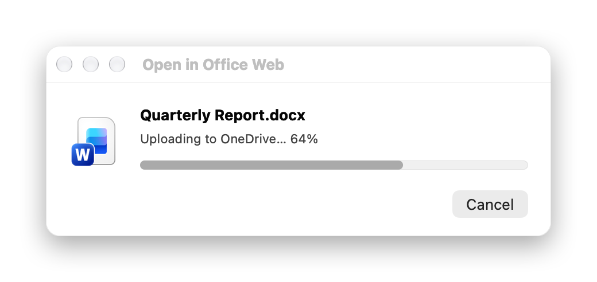
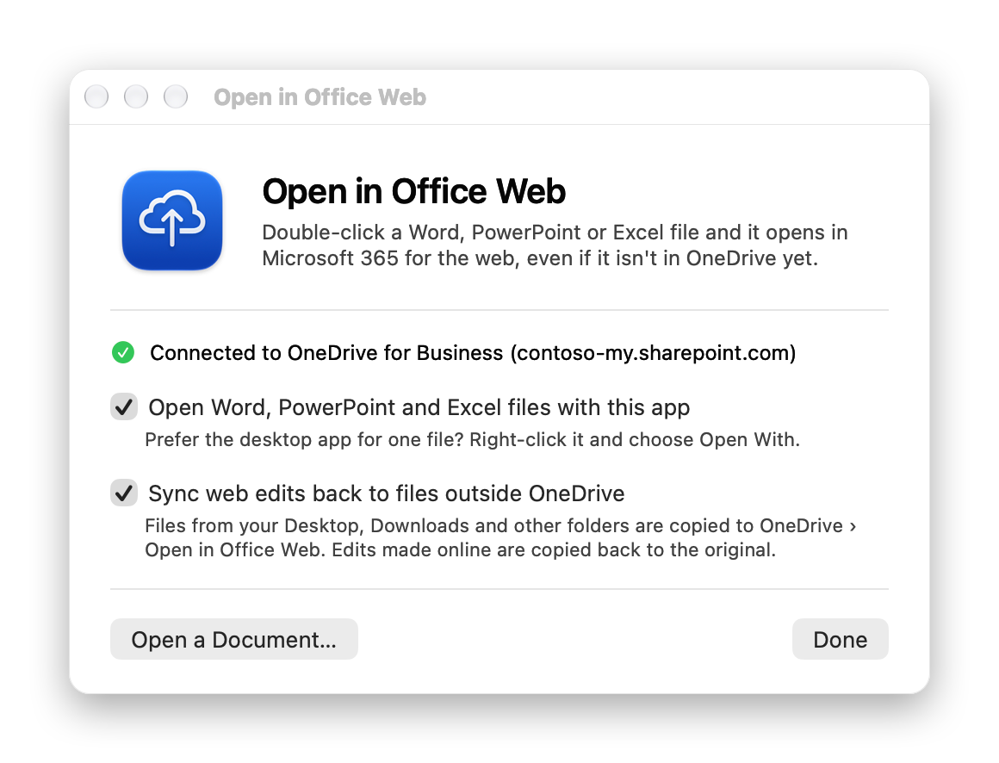
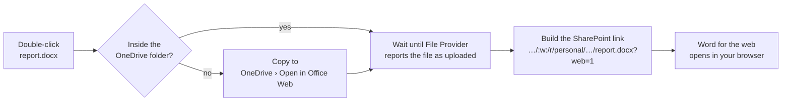
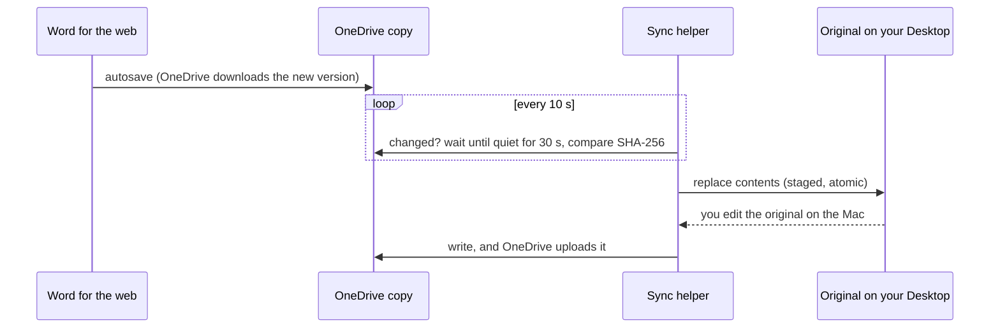

<div align="center">



# Open in Office Web

**Double-click a Word, PowerPoint or Excel file on your Mac and it opens in Microsoft 365 for the web, even if it isn't in OneDrive yet.**

[](https://github.com/chdominguez/open-in-office-web/releases/latest)


[](LICENSE)

<picture>
  <source media="(prefers-color-scheme: dark)" srcset="docs/images/progress-dark.png">
  
</picture>

</div>

## Why

Office for the web is often all you need: it's fast, always up to date, autosaves, and shows your colleagues' edits live. But on a Mac, double-clicking a `.docx` launches the heavyweight desktop app, and a file in Downloads or on your Desktop can't be opened online at all until you upload it yourself.

Open in Office Web is a tiny native app (under 2 MB, no Electron) that becomes the default app for Office documents and does the rest for you:

- **Files already in OneDrive** open straight in Word, PowerPoint or Excel for the web.
- **Files anywhere else** (Desktop, Downloads, an email attachment) are copied to a OneDrive folder. The app waits until OneDrive has finished uploading and then opens the copy online.
- **Sync back:** edits you make online are copied back to the original file, and edits to the original go up to OneDrive.
- **Native sync status:** progress comes from macOS's File Provider API, the same source Finder uses for its cloud icons. Nothing is guessed.
- **Falls back gracefully:** if OneDrive is offline or an upload fails, you get one click to open the file in the desktop app instead.
- **English and Spanish**, following your system language.

## Install

1. Download **`OpenInOfficeWeb-x.y.z.dmg`** from the [latest release](https://github.com/chdominguez/open-in-office-web/releases/latest) and drag the app to **Applications**.
2. Open it. The app isn't notarized by Apple yet (see [below](#why-does-macos-say-the-app-cant-be-verified)), so the first time:
   - **macOS 15 and later:** macOS shows a warning. Click **Done**, open **System Settings › Privacy & Security**, scroll down and click **Open Anyway**.
   - **macOS 13–14:** right-click the app, choose **Open**, then confirm.
3. In the welcome window, turn on what you want:

<div align="center">
<picture>
  <source media="(prefers-color-scheme: dark)" srcset="docs/images/welcome-dark.png">
  
</picture>
</div>

| Option | What it does |
|---|---|
| **Open Word, PowerPoint and Excel files with this app** | Makes the app the default for `.docx` `.doc` `.pptx` `.ppt` `.xlsx` `.xls`. Turn it off to give the files back to the Office desktop apps. To use the desktop app for a single file, right-click it and choose **Open With**. |
| **Sync web edits back to files outside OneDrive** | Registers a small background helper (*Open in Office Web Sync*) as a login item. The first time, macOS asks you to allow it under **System Settings › General › Login Items**. |

You can reopen this window at any time by launching the app from Applications or Launchpad.

**Requirements:** macOS 13 Ventura or later, and the [OneDrive app](https://www.microsoft.com/microsoft-365/onedrive/download) signed in with a **work or school** (Microsoft 365 / Entra ID) account.

## How it works



1. **Finding OneDrive.** OneDrive for Business syncs to `~/Library/CloudStorage/OneDrive-<Org>`. The app finds that folder and reads your SharePoint address (`https://<tenant>-my.sharepoint.com/personal/<you>`) from the `.url` shortcut OneDrive keeps in it. No sign-in and no Microsoft Graph calls are needed.
2. **Waiting for the upload.** Instead of sleeping and hoping, the app polls the [`ubiquitousItemIsUploaded`](https://developer.apple.com/documentation/foundation/urlresourcevalues/ubiquitousitemisuploaded), `IsUploading` and `UploadingError` resource values that OneDrive's File Provider extension publishes to macOS.
3. **Opening the right URL.** A plain SharePoint file URL makes the browser *download* the document. The app builds the same kind of link OneDrive's "Copy link" generates: `/:w:/r/…` for Word, `/:p:/r/…` for PowerPoint, `/:x:/r/…` for Excel. That link always opens in Office for the web.

### Sync back

Office for the web saves to the copy in OneDrive, not to your original file. The sync helper closes that gap:



- **Following the original:** each copy is linked to its original with a macOS bookmark, so the link survives moving or renaming the original.
- **Conflicts:** if both sides changed, the original is never overwritten. The web version is saved next to it as `report (web version).docx`, and you get a notification.
- **Cleanup:** copies untouched for 7 days are moved to the OneDrive recycle bin, unless they hold web edits that haven't reached the original yet.
- **Where things are stored:** links in `~/Library/Application Support/OpenInOfficeWeb/links.json`, activity in `~/Library/Logs/OpenInOfficeWeb.log`.

## Privacy

The app makes **no network requests** of its own and has **no telemetry**. It reads and writes files on your Mac. OneDrive does the uploading, and your browser opens the document. Everything runs locally.

## FAQ

#### Why does macOS say the app can't be verified?
Notarization requires a paid Apple Developer ID, which this project doesn't have yet. The release is built in the open by [GitHub Actions](.github/workflows/release.yml) from this source code. You can also [build it yourself](#build-from-source) in under a minute. If you'd rather skip the Gatekeeper prompt after downloading, run:
```sh
xattr -dr com.apple.quarantine "/Applications/Open in Office Web.app"
```

#### Does it work with personal OneDrive or SharePoint team sites?
Not yet. Only OneDrive for Business (work or school) is supported. Files in synced SharePoint libraries (`OneDrive-SharedLibraries-…`) are handled like files outside OneDrive: they are copied first.

#### Can it open documents in their own app window instead of a browser tab?
That's being explored on the [roadmap](#roadmap). Meanwhile you can install Office for the web as a Safari web app (**File › Add to Dock** on `word.cloud.microsoft`).

#### How do I uninstall it?
Open the app and turn off both options, then delete the app. Optionally also delete `~/Library/Application Support/OpenInOfficeWeb` and the `Open in Office Web` folder in OneDrive.

## Build from source

You only need the Xcode Command Line Tools (`xcode-select --install`); the full Xcode isn't required.

```sh
git clone https://github.com/chdominguez/open-in-office-web.git
cd open-in-office-web
./build.sh --install        # universal build, copied to ~/Applications
./scripts/make-dmg.sh       # dist/OpenInOfficeWeb-<version>.dmg
```

| Path | What's there |
|---|---|
| `Sources/App.swift` | Opening flow: copy, wait for upload, open the web URL |
| `Sources/OneDrive.swift` | OneDrive detection, SharePoint URLs, File Provider sync state |
| `Sources/SyncAgent.swift` | Background sync helper (`--agent`) |
| `Sources/SyncLinks.swift` | Link store (original ↔ copy) with file locking |
| `Sources/WelcomeWindow.swift`, `Integration.swift` | Onboarding, default app, login item (`SMAppService`) |
| `Resources/*.lproj` | Translations |

README screenshots are rendered from the real UI: `"build/Open in Office Web.app/Contents/MacOS/OpenInOfficeWeb" --render-screenshots docs/images`.

To sign and notarize with your own Developer ID:
```sh
SIGN_IDENTITY="Developer ID Application: Your Name (TEAMID)" NOTARY_PROFILE=notary ./scripts/make-dmg.sh
```

## Roadmap

- [ ] Notarized releases and a Homebrew cask
- [ ] Native document windows (WKWebView) instead of browser tabs
- [ ] Personal OneDrive and SharePoint document libraries
- [ ] More languages

## Contributing

Issues and pull requests are welcome. To add a language, copy `Resources/es.lproj` to `Resources/<code>.lproj`, translate it, add the code to `CFBundleLocalizations` in `Resources/Info.plist`, and run `./scripts/check-strings.sh`.

## License

[MIT](LICENSE) © Christian Domínguez. Not affiliated with Microsoft. Microsoft 365, OneDrive, Word, PowerPoint and Excel are trademarks of Microsoft Corporation.
